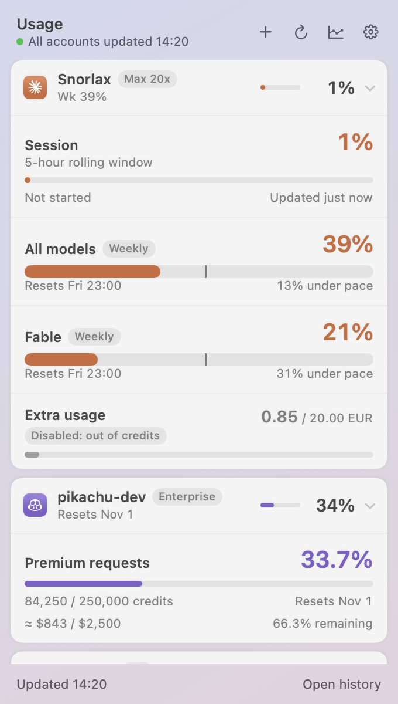
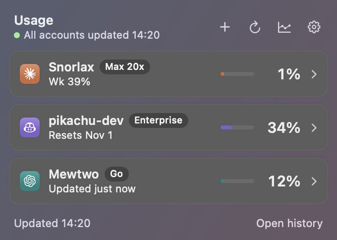
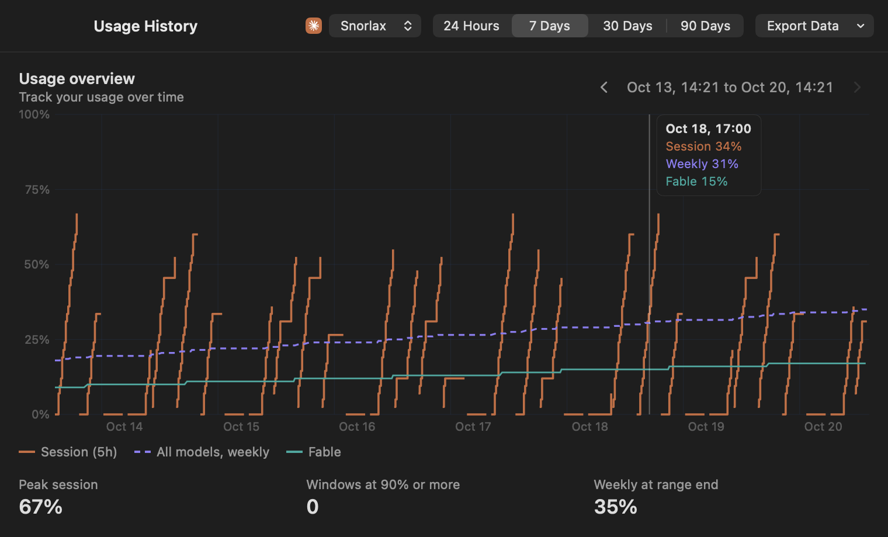
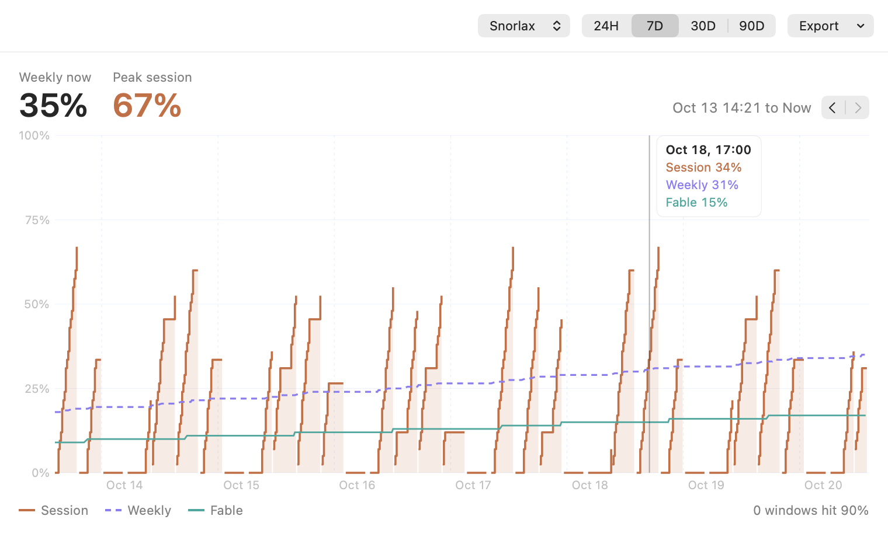
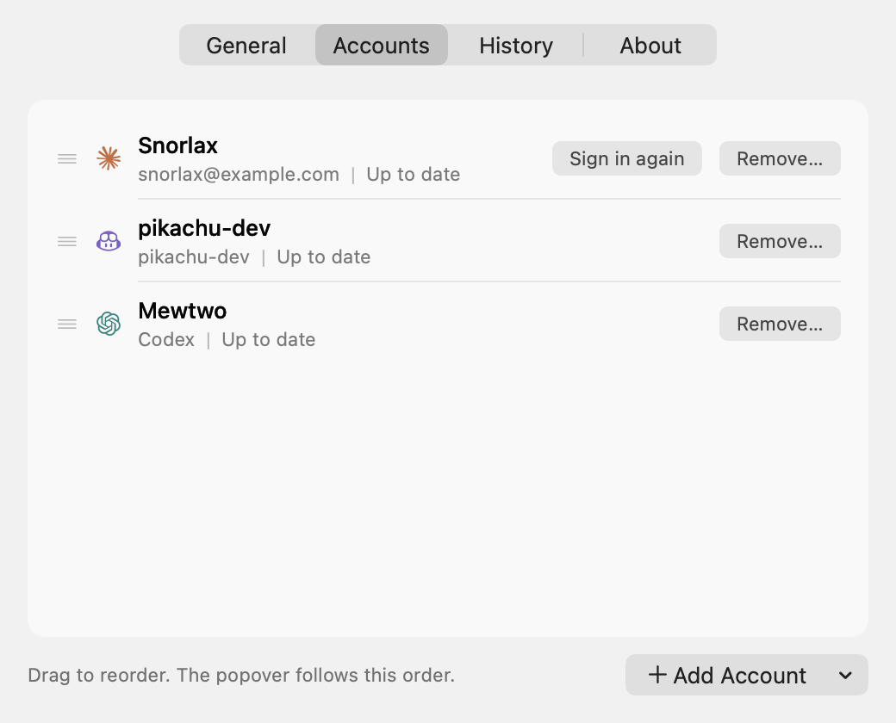
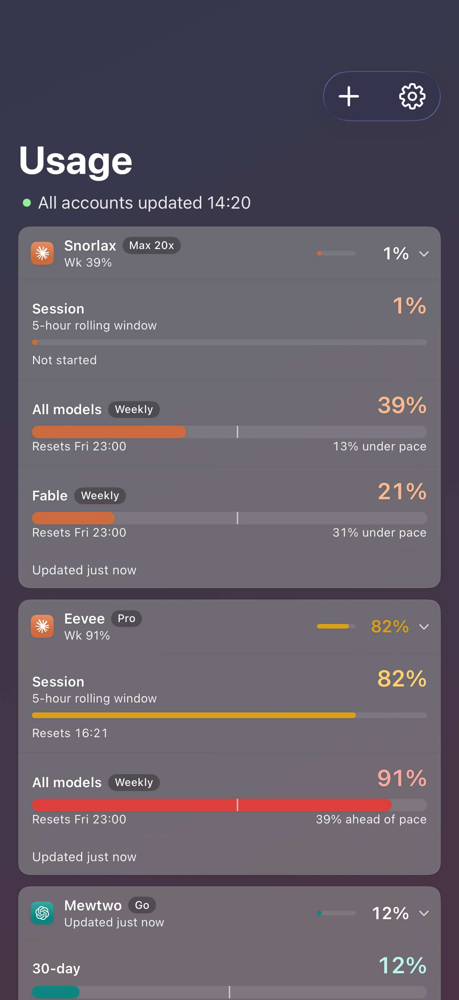
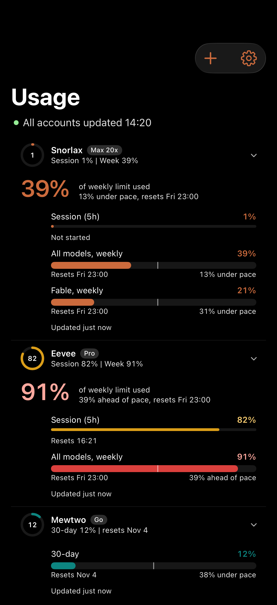

# Agent Hourglass

macOS menu bar app that shows plan usage for Claude, GitHub Copilot, and OpenAI Codex accounts: current session and weekly meters in a popover, a menu bar icon for one chosen account, and a History window with charts and export.

## Demo

Screenshots use fixture data with placeholder account names (Snorlax, pikachu-dev, Mewtwo).

| Popover (Glass, expanded) | Popover (Glass, dark, collapsed) |
|---|---|
|  |  |

**Usage History**, Glass theme (dark):



**Usage History**, Instrument theme (light):



**Settings > Accounts**:



## Install

Requires macOS 14 or later.

1. Download `AgentHourglass-<version>.zip` from [Releases](https://github.com/math120908/agent-hourglass/releases) (latest: v1.0.16).
2. Unzip and move `AgentHourglass.app` to `~/Applications` or `/Applications`.
3. Open it. The app is signed with Developer ID and notarized by Apple, so it opens without a Gatekeeper warning. It lives in the menu bar (no Dock icon).

Or build from source:

```bash
make install   # builds and copies to ~/Applications/AgentHourglass.app
```

Build requirements, signing, and versioning are in [DEVELOPMENT.md](DEVELOPMENT.md).

The app installs as `~/Applications/AgentHourglass.app`. It is a different app from Anthropic's `/Applications/Claude Usage.app` (note the space); never overwrite or delete that one.

When macOS asks for Keychain access, click **Allow**, never **Always Allow**. The app only reads its own items.

## iPhone

The iPhone app shows Claude and Codex accounts: each card has the 5-hour and weekly windows with reset times, and Home Screen and Lock Screen widgets show the most constrained window.

| Glass | Instrument |
|---|---|
|  |  |

Install: TestFlight, invite only. Accept the invite, then open **TestFlight** > **Agent Hourglass** > **Install**.

Sign-in, per provider:

- **Claude**: open claude.ai in a private system browser sheet, sign in (any method, Google included), copy the code it shows, and paste it back into the app.
- **Codex**: device code. The app shows a code; enter it on the provider page.

The phone signs in on its own and never reads the Mac's credentials.

Data locations on the phone: Keychain service `cc.kuoc.agent-hourglass` (this device only, never synced), App Group `group.cc.kuoc.agent-hourglass`.

Known limits: TestFlight builds expire after 90 days.

## Accounts

Settings > Accounts > **Add Account** menu (the list refreshes as soon as an account is added). Settings > History has an **Open Usage History** link.

- **Claude** opens the browser OAuth login. The token is stored in the Keychain under service `cc.kuoc.agent-hourglass`. The app never reads Claude Code's own credential.
- **GitHub Copilot** uses the GitHub CLI. Install `gh` (Homebrew) and run `gh auth login` first; the app asks `gh` for the token on each poll and does not store it.
- **Claude Code (local, read-only)** (Add Account > Claude > Claude Code (local, read-only)) reuses the login Claude Code keeps in your Keychain. macOS asks once for access: click **Always Allow**. The app only reads that item on each poll, keeps the token in memory, and never writes, refreshes, or changes it. When the token is near expiry it shows "Run `claude` to refresh login"; using Claude Code refreshes it. Experimental.
- **Codex** reads the Codex CLI login from `~/.codex/auth.json` (read-only; run `codex login` first). The app never refreshes or writes that file. Meters are labelled by window length (for example `30-day`).

## Codex reset radar

Codex cards show a **Reset radar** row: when Codex usage limits were last reset globally, and the 5 most recent reset or credits events (click one to open the post). The app checks [codex-reset.com](https://codex-reset.com) about once an hour and posts a notification when a new confirmed reset appears. Settings > General > **Codex reset radar** has three switches: show the radar, reset notifications, and notifications for credits events too (off by default). On first launch existing events are marked as seen, so no backlog of notifications. Seen events are stored in `UserDefaults` key `resetRadar.seenKeys`.

## Themes

Two looks, switchable at any time in Settings > General > **Theme**:

- **Glass** (default): frosted cards per account.
- **Instrument**: ring gauges in a hairline list, larger figures in History.

The choice is stored in `UserDefaults` key `theme` and applies immediately to the menu bar icon, the popover, and an open History window. From a shell: `defaults write cc.kuoc.agent-hourglass theme instrument` (or `glass`).

## History and export

Usage samples are kept in a local SQLite file. Raw samples are kept for 90 days (30 if `historyRawDays` is set to 30, or automatically if the file grows past 100 MB), then rolled up to hourly points kept for 2 years.

The History window shows 24 Hours, 7 Days, 30 Days, or 90 Days. **Export Data** saves CSV or JSON for the selected account; hold Option while choosing to export all accounts.

## Data locations

| Path | Mode | Content |
|---|---|---|
| `~/Library/Application Support/cc.kuoc.agent-hourglass/` | 700 | app support dir |
| `.../accounts.json` | 600 | account list (display names, ids, gh login) |
| `.../history.sqlite` (+ `-wal`, `-shm`) | 600 | usage history |
| `.../instance.lock` | 600 | single-instance lock |
| Keychain, service `cc.kuoc.agent-hourglass` | | Claude OAuth tokens |

Versions before the rename used `cc.kuoc.claude-usage`. On first launch the app moves the old app support dir (if the new one is absent), copies missing `UserDefaults` keys, moves each Claude token to the new Keychain service (read, write, read back, then delete the old item; a denied read leaves the old item and the account shows "needs sign-in"), and re-registers launch at login if it was on. It runs once; outcomes are logged under category `Migration`.

Logs go to the unified log, subsystem `cc.kuoc.agent-hourglass`. Tokens are never logged. About > **Copy diagnostics** hashes account ids and contains no tokens, emails, or names.

## Uninstall

```bash
pkill -x AgentHourglass
rm -rf ~/Applications/AgentHourglass.app
rm -rf ~/Library/Application\ Support/cc.kuoc.agent-hourglass
# Keychain items (repeat until "could not be found"):
security delete-generic-password -s cc.kuoc.agent-hourglass
security delete-generic-password -s cc.kuoc.agent-hourglass.cli
# Leftovers from the old cc.kuoc.claude-usage id, if present:
rm -rf ~/Library/Application\ Support/cc.kuoc.claude-usage
defaults delete cc.kuoc.claude-usage
security delete-generic-password -s cc.kuoc.claude-usage
security delete-generic-password -s cc.kuoc.claude-usage.cli
```

If launch at login was on, turn it off in Settings first (or remove AgentHourglass from System Settings > General > Login Items).

## Known limits

- Usage endpoints are undocumented and may change; unknown fields show as a schema error and appear in diagnostics.
- Polling backs off on HTTP 429 (at least the Retry-After value, minimum 60 s), so a card can show "Rate limited" for a while.
- Copilot requires `gh`; removing the login from `gh` shows "Login not in gh".
- Notifications cover Codex reset events only, not usage thresholds.

## Disclaimer and icon credits
This is an unofficial personal tool. It is not affiliated with, endorsed by, or sponsored by Anthropic, GitHub, Microsoft, or OpenAI.
Claude, GitHub Copilot, Codex, and OpenAI are trademarks of their respective owners. The provider logos are used only to show which service an account belongs to.
Codex reset timeline data from [codex-reset.com](https://codex-reset.com).
Provider icon SVGs come from [Simple Icons](https://simpleicons.org) (CC0-1.0); the trademarks themselves remain with their owners.

## License

[MIT](LICENSE). The license covers this project's code only; provider names and logos remain trademarks of their owners (see above).
